# Robot Console and Calibration

A walk-through of the class day where students connect their robot to the
laptop, run the initial calibration, and put the calibration values into
their first MakeCode program.

<!--more-->

## 1. Get a laptop and the robot ready

Get a laptop and your robot. Log in to the laptop and set the robot up next
to it for the initial calibration.

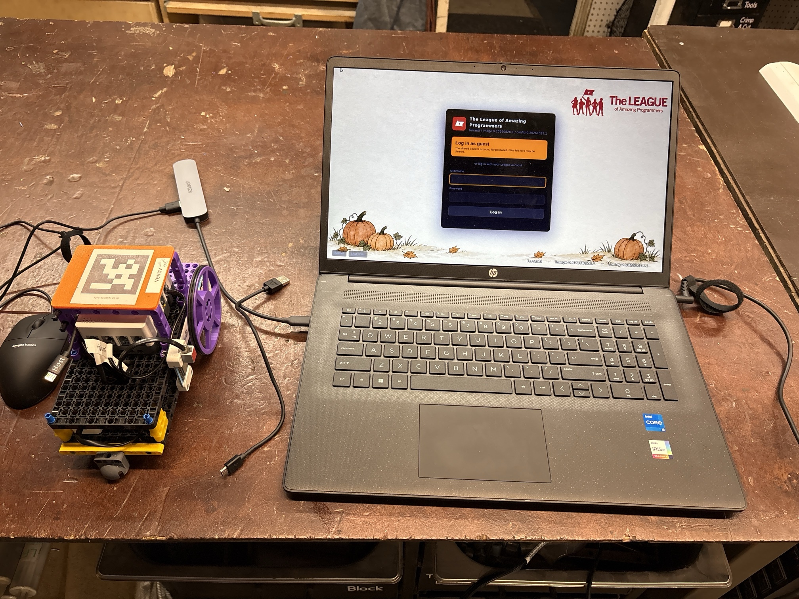

## 2. Open the robot console

Open the robot console on the laptop. It opens on the **Devices** page, with
a card for each robot it can see.

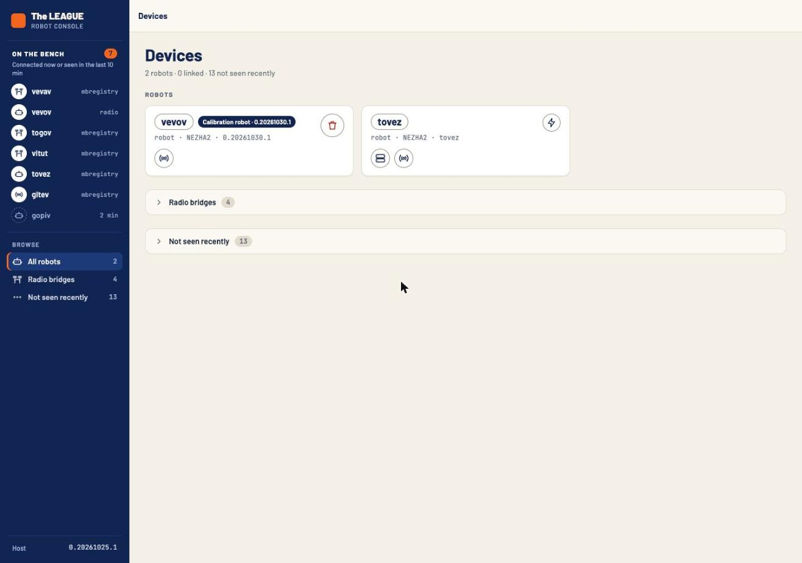

## 3. Plug in the robot and flash the firmware

Plug the robot into the laptop with the USB cable.

- If this robot has been plugged into the robot console before, it shows up
  in the list of robots at the top.
- Otherwise it shows up under **Unknown devices**.

Click the round **Flash** button in the upper right and flash the robot
firmware.

## 4. Line the robot up on the wheel-measuring mat

Put your robot on the wheel-measuring mat. Line up the red lights on the
robot with the red dots on the mat, so the robot is ready to measure its
wheels.

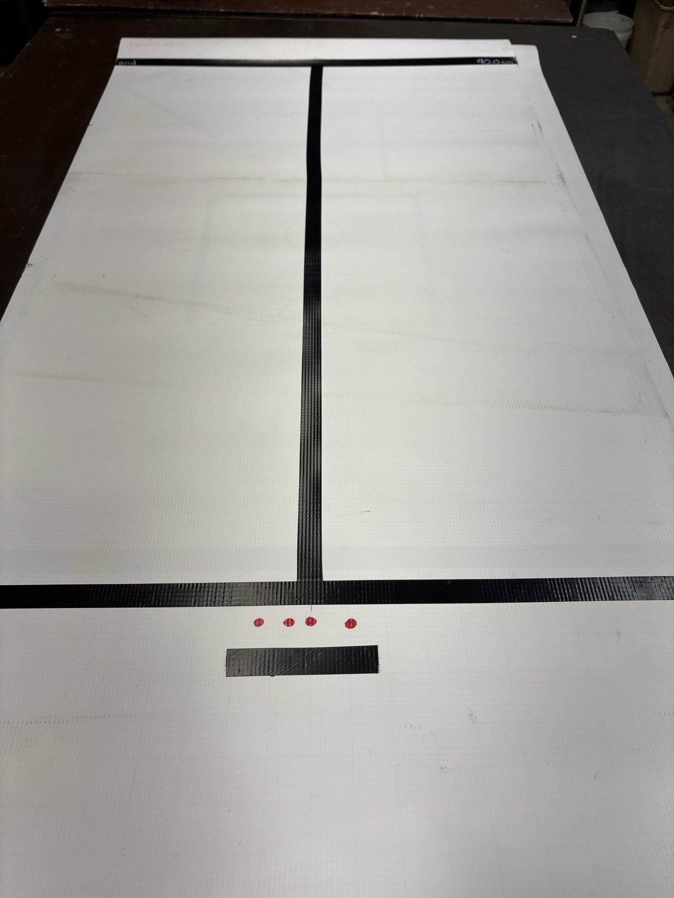

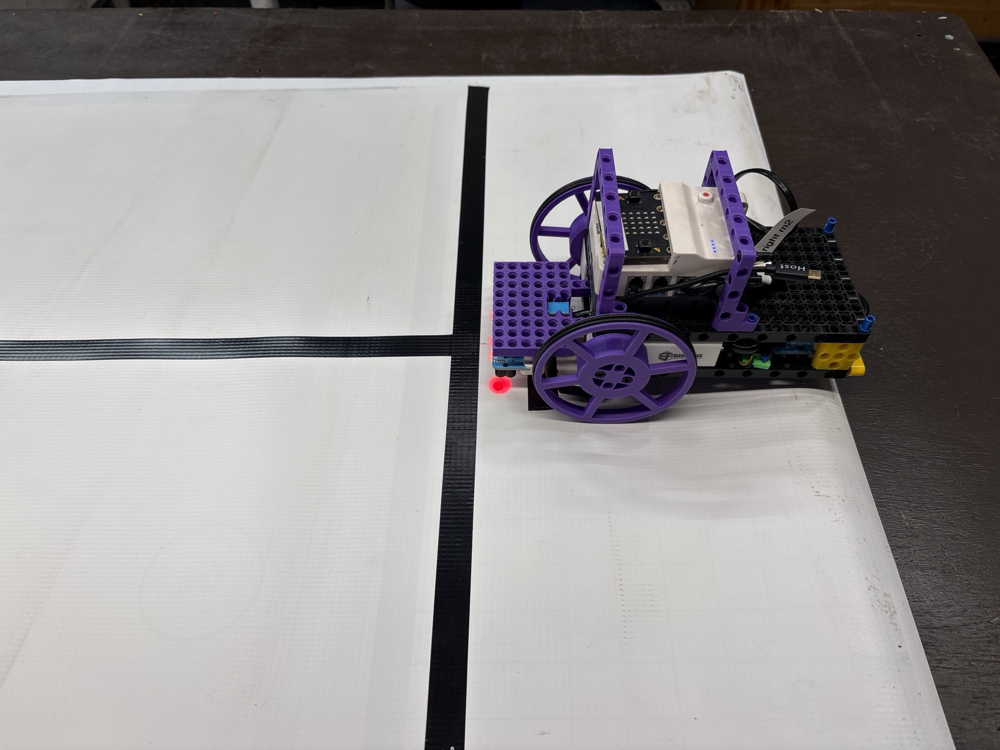

## 5. Connect to the robot over the radio

You should be able to start the robot over the radio. In the robot console,
click on the radio, find your robot in the list, and click its connection
button.

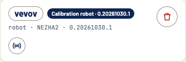

When the robot is linked, its card turns green. Click the orange arrow to
open the robot.

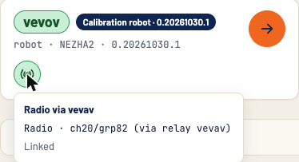

## 6. Calibrate the wheels

Once you're connected to the robot, go to the **Calibration** tab.

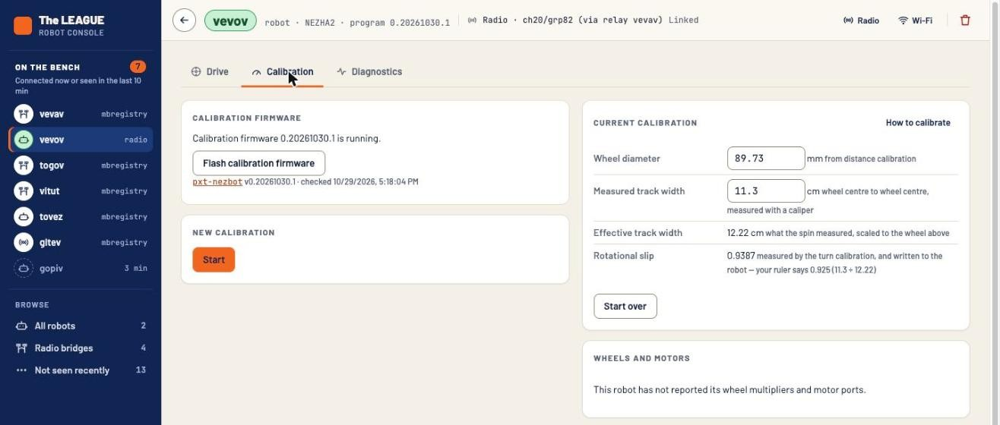

Start a new calibration: press **Start** under **New calibration**.

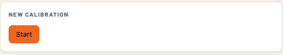

Type in the line-to-line distance on the mat, measured with a tape measure
(90 cm in these pictures). The **Calibrate wheels** and **Calibrate turns**
buttons appear.

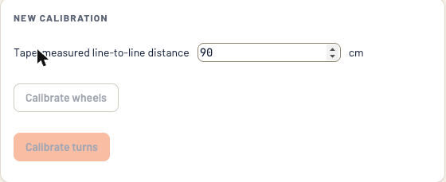

If the buttons stay greyed out, look at the top of the page. The radio link
times out when the robot sits idle, and the header then says **Not
connected**. Press **Connect** to link up again.

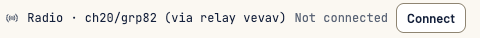

Then calibrate the wheels. The robot should start driving down the center
line.

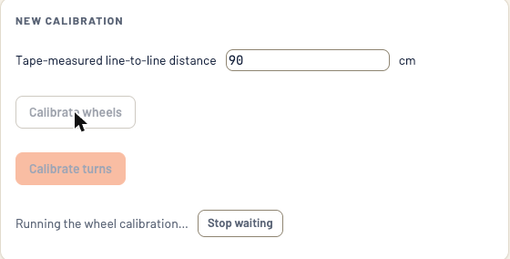

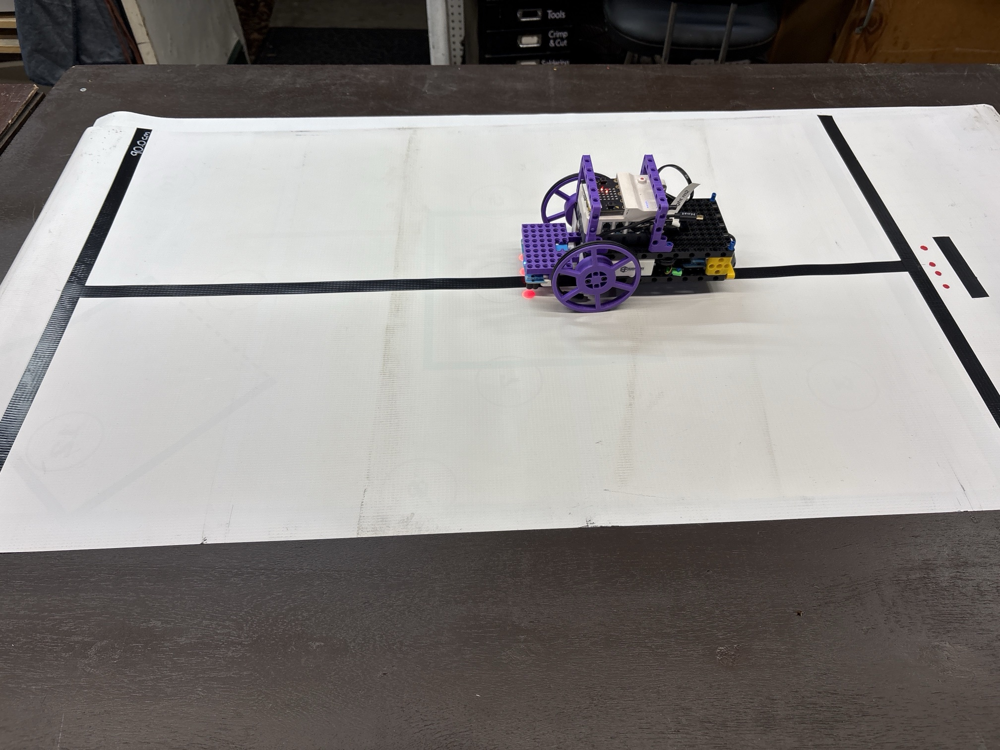

When the robot stops, the console shows the result next to the button.

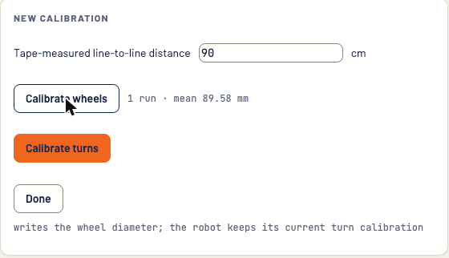

You can run the wheel calibration more than once. Two or three wheel runs
will average out any errors in a single run.

Under **Current calibration**, the wheel diameter now has its new value.
Effective track width stays empty until you calibrate turns.

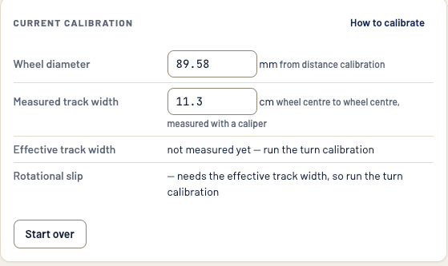

## 7. Calibrate turns on the Iron Cross target

To calibrate turns you need the **Iron Cross** target. There is a bigger one
and a smaller one; pick either, as long as your robot fits on it completely.

Line the robot up on the target:

- The center line of the robot, the line that runs right between the
  reflectors on the front and the back, goes along one line of the target.
- The axles go along the perpendicular line, so the robot's center of
  rotation is right in the middle of the target.

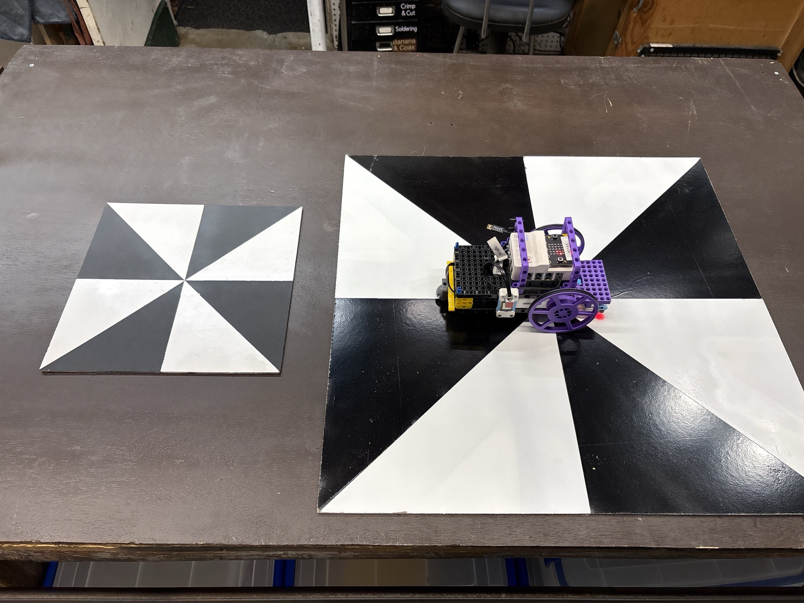

Click the **Calibrate Turns** button and watch your robot spin around.

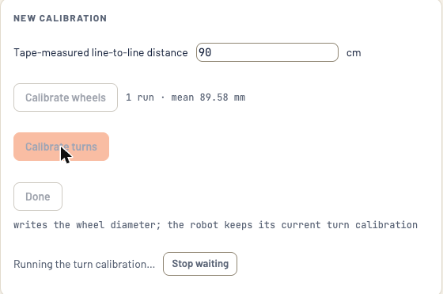

If you run the turn calibration more than once, re-center the robot on the
target before each run.

When you've finished your runs, press **Done**. It writes the averages to
the robot.

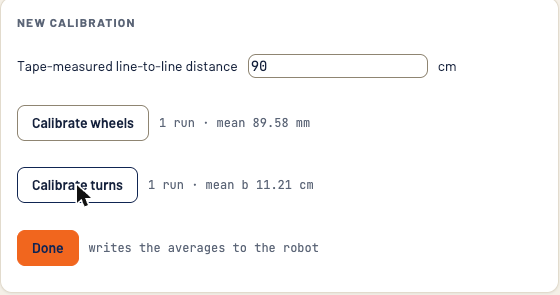

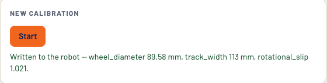

## 8. Check the calibration values

On the calibration page, look under **Current calibration**. You now have
values for **wheel diameter** and **effective track width**.

If you measured the track width yourself with calipers (not covered here),
that value shows up too. The most important values are the effective track
width and the wheel diameter.

These are the two numbers you need. Write them down; you'll put them into
your program in step 11.

- **Wheel diameter**, from the wheel calibration, in millimeters: 89.58 mm
  in this picture.
- **Effective track width**, from the turn calibration, in centimeters:
  11.21 cm in this picture.

Use the effective track width, not the `track_width` in the message after
**Done** (113 mm here). That one is the caliper measurement.

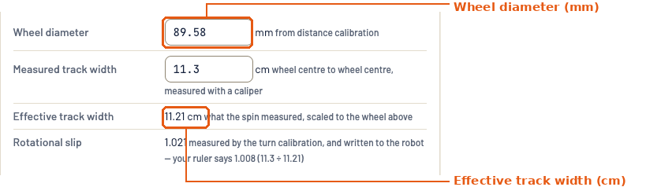

## 9. Open the example program in MakeCode

Now put those values into a program. Start from the example program for the
class robot, [pxt-nezha-guvug](https://github.com/League-Robotics/pxt-nezha-guvug).
It's also listed on the [Code](/code/) page.

1. Open MakeCode for micro:bit at <https://makecode.microbit.org/>.
2. On the home page, click **Import**, then **Import URL**.
3. Paste `https://github.com/League-Robotics/pxt-nezha-guvug` and import it.

MakeCode opens the example as a new project of your own, saved in the
browser. Changing it doesn't change the example on GitHub.

<!-- TODO: screenshot of the Import URL dialog -->

## 10. Rename the project

The example is named **Guvug**, after a different robot. Click the project
name in the box at the bottom of the editor and change it to your robot's
name.

<!-- TODO: screenshot of the project name box -->

## 11. Enter your calibration values

In the **on start** block, find these two blocks and put in the values from
the robot console's **Current calibration**:

- **set wheel perimeter** is the distance around the wheel, not the wheel
  diameter. The console gives the diameter in millimeters, so divide it by 10
  to get centimeters, then multiply by π (3.1416). For example, a wheel
  diameter of 89.58 mm is 8.958 cm, and 8.958 × 3.1416 = 28.14 cm.
- **set wheel base** is your effective track width. It's already in
  centimeters, so put it in as it is: 11.21 cm in the example.

Both blocks are set to centimeters.

<!-- TODO: screenshot of the on start block with the two values -->

## 12. Flash the program and try it

Plug the robot into the laptop and click **Download** to flash the program.

- Press **B** and the robot drives a square, 20 cm on a side. Hold **B** to
  stop it after the side it's on.
- Put the robot on a line and press **A** and it follows the line. Press
  **A** again to stop it.

If the square doesn't close up, or the corners aren't square, check the two
values you entered in step 11.
